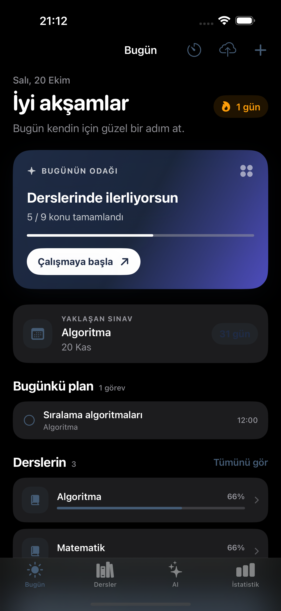
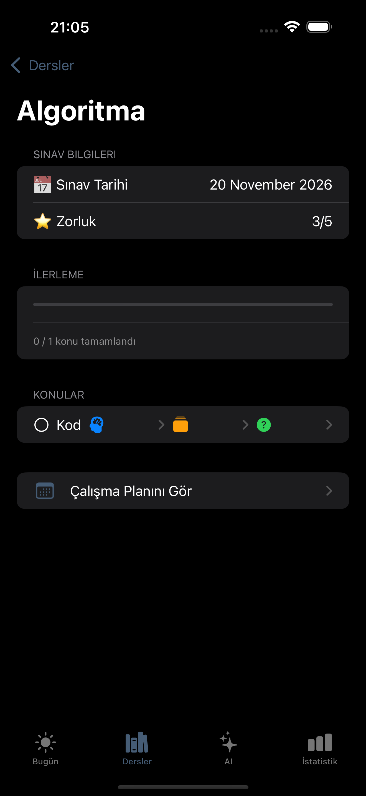
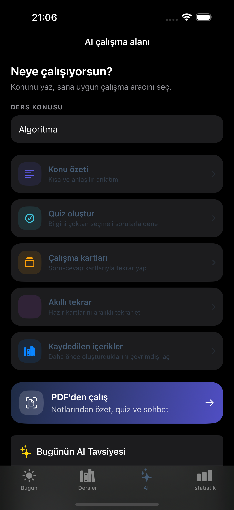

# StudyFlow AI

StudyFlow AI is a SwiftUI study-planning app for iOS. It helps students organize courses and exams, stay on top of daily study tasks, track progress, and turn learning materials into interactive study tools.

## Features

- Create courses, add topics, set exam dates, and organize daily study tasks.
- Track completed topics, course progress, upcoming exams, and study streaks.
- Generate concise topic summaries, multiple-choice quizzes, and flashcards with AI.
- Save generated materials for offline access and review flashcards with spaced repetition.
- Import PDFs and extract selectable text. Scanned pages can be recognized on-device with Apple Vision OCR.
- Generate AI summaries from PDF notes and ask questions about their contents.
- Use a focus timer, schedule study reminders, and back up study data.

## Technology

- SwiftUI for the iOS app interface.
- On-device local storage for courses, topics, and study progress.
- A Node.js development proxy for Google Gemini API requests.
- Apple Vision OCR for text recognition in scanned PDF pages.

The Gemini API key must stay on the proxy server. Configure it in `backend/.env`, which is ignored by Git. The repository includes `backend/.env.example` as a template. Never commit a real API key.

## Requirements

- Xcode 16 or later
- iOS 18.2 or later
- Node.js 18 or later for AI features
- A Google AI Studio Gemini API key

## Run the app

Open `StudyFlowAI.xcodeproj` in Xcode, select the `StudyFlowAI` scheme and an iOS Simulator device, then run the app.

To enable AI features in the simulator, create `backend/.env` from the example file, add your Gemini API key, and start the proxy:

```sh
cd backend
cp .env.example .env
node server.mjs
```

Keep the proxy terminal open while using the app. Check its status at `http://127.0.0.1:3000/health`.

## Deployment note

The included Node.js proxy is intended for local development and should not be exposed directly to the public internet. Before distributing the app to real users, deploy the proxy behind HTTPS and add user authentication and abuse protection. A physical iPhone also needs a reachable HTTPS proxy address; `127.0.0.1` only works for the Mac-hosted simulator.

## Screenshots

| Today | Course details | AI study workspace |
|---|---|---|
|  |  |  |

